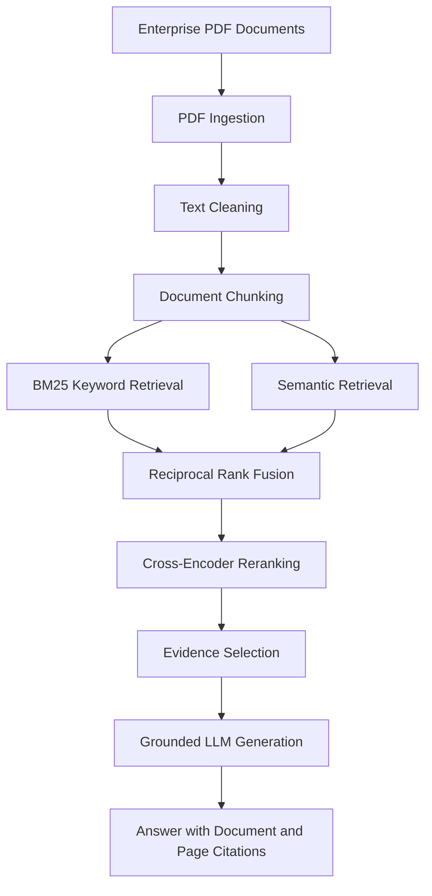

# Enterprise AI Knowledge Platform

[](https://github.com/srinathreddy-dev/enterprise-ai-knowledge-platform/actions/workflows/ci.yml)
[](https://github.com/srinathreddy-dev/enterprise-ai-knowledge-platform/actions/workflows/docker-build.yml)

A production-oriented enterprise knowledge platform that transforms internal PDF documents into searchable knowledge and generates grounded answers with supporting evidence.

Built with Python, FastAPI, hybrid retrieval, cross-encoder reranking, OpenAI, Docker, Prometheus, Grafana, and cAdvisor.

## Architecture

The platform uses a hybrid retrieval-augmented generation (RAG) pipeline. PDF documents are ingested, cleaned, and split into chunks. BM25 and semantic retrieval run in parallel; their results are fused with Reciprocal Rank Fusion (RRF), reranked, and passed to grounded answer generation.



## Key Features

- PDF ingestion and text extraction
- Text cleaning and word-aware document chunking
- BM25 keyword-based retrieval
- Semantic vector retrieval
- Hybrid retrieval with Reciprocal Rank Fusion (RRF)
- Cross-encoder reranking
- Grounded LLM answer generation
- Evidence-based answers with document and page citations
- Prompt injection-resistant instructions for retrieved content
- FastAPI REST API
- Structured JSON application logging
- Prometheus metrics and Grafana dashboards
- Docker-based deployment
- Container monitoring with cAdvisor

## Technology Stack

| Area | Technologies |
|---|---|
| Language | Python 3.13 |
| API | FastAPI, Uvicorn |
| Document Processing | PyMuPDF |
| Retrieval | BM25, Sentence Transformers |
| Reranking | Cross-Encoder |
| LLM | OpenAI API |
| Monitoring | Prometheus, Grafana, cAdvisor |
| Containerization | Docker, Docker Compose |
| Testing | Pytest |

## Project Structure

```text
enterprise-ai-knowledge-platform/
├── app/
│   ├── api/
│   ├── core/
│   ├── evaluation/
│   ├── generation/
│   ├── ingestion/
│   ├── monitoring/
│   ├── reranking/
│   ├── retrieval/
│   └── main.py
├── data/
│   ├── raw/
│   └── sample/
├── monitoring/
│   └── prometheus.yml
├── scripts/
├── tests/
├── compose.yaml
├── Dockerfile
├── pyproject.toml
└── README.md
```

## Getting Started

### Prerequisites

- Python 3.13
- Docker Desktop
- An OpenAI API key

### 1. Clone the repository

```bash
git clone <YOUR_GITHUB_REPOSITORY_URL>
cd enterprise-ai-knowledge-platform
```

### 2. Create and activate a virtual environment

```bash
python3.13 -m venv .venv
source .venv/bin/activate
```

### 3. Install dependencies

```bash
pip install --upgrade pip
pip install .
```

### 4. Configure the OpenAI API key

Set your API key as an environment variable:

```bash
export OPENAI_API_KEY="your-api-key"
```

Never commit API keys or other secrets to Git.

### 5. Start the API

```bash
uvicorn app.main:app --reload
```

The API will be available at:

http://localhost:8000

Interactive API documentation:

http://localhost:8000/docs

## API Endpoints

| Method | Endpoint | Description |
|---|---|---|
| GET | `/health` | Application health check |
| GET | `/ready` | Application readiness check |
| GET | `/metrics` | Prometheus metrics |
| POST | `/ask` | Ask a question about ingested documents |

### Example request

```bash
curl -X POST http://localhost:8000/ask \
  -H "Content-Type: application/json" \
  -d '{"question": "What is the company leave policy?"}'
```

The response includes the generated answer and supporting evidence, including document names, page numbers, chunk IDs, and relevance scores.

## Testing

Run the automated test suite:

```bash
pytest -v
```

The project includes tests covering ingestion, retrieval, reranking, generation, API behavior, and error handling.

## Docker Deployment

Build and start the application and monitoring stack:

```bash
docker compose up -d --build
```

Check running services:

```bash
docker compose ps
```

View application logs:

```bash
docker compose logs -f api
```

Stop the services:

```bash
docker compose down
```

## Monitoring and Observability

The platform includes a monitoring stack using Prometheus, Grafana, and cAdvisor.

| Service | Local URL |
|---|---|
| FastAPI | http://localhost:8000 |
| API documentation | http://localhost:8000/docs |
| Prometheus | http://localhost:9090 |
| Grafana | http://localhost:3000 |
| cAdvisor | http://localhost:8080 |

### Monitoring capabilities

- Total API requests
- API request rate
- Average API response time
- HTTP 5xx error rate
- API availability
- Docker container CPU usage
- Docker container memory usage
- Docker host network receive and transmit rates

### Configured alert rules

- Docker High CPU Usage
- Docker High Memory Usage
- Enterprise AI API Down

Email alert delivery requires a correctly configured Grafana contact point and SMTP settings.

## Configuration

| Variable | Description |
|---|---|
| `OPENAI_API_KEY` | OpenAI API authentication key |
| `OPENAI_MODEL` | OpenAI model used for answer generation |
| `APP_NAME` | Application name |
| `ENVIRONMENT` | Application environment |

## Engineering Considerations

- Evidence-grounded responses reduce unsupported answers.
- Hybrid retrieval combines keyword and semantic search.
- Cross-encoder reranking improves the relevance of retrieved evidence.
- API errors are handled with appropriate HTTP status codes.
- Prometheus metrics provide visibility into API performance.
- Docker volumes preserve monitoring data and downloaded model caches.
- Secrets are supplied through environment variables rather than hardcoded in source code.

## Future Improvements

- Authentication and role-based access control
- Multi-tenant document isolation
- Cloud deployment with Kubernetes
- Automated CI/CD pipelines
- Advanced retrieval evaluation
- Document versioning and access controls
- Distributed tracing and deeper observability

## License

This project is intended as a portfolio and learning project.
